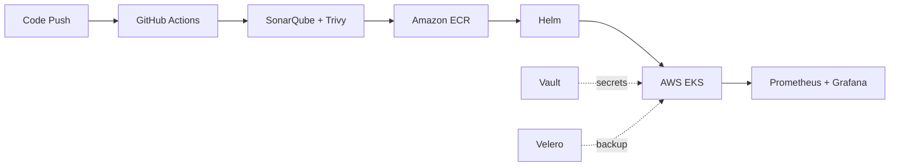

<!-- ===================== HEADER ===================== -->

 

---

## 👨‍💻 About Me

I'm a **Junior DevOps Engineer** with a **Software Engineering** foundation and a B.Sc. in Electronics & Communication Engineering. I design and automate the path from code to production: **CI/CD pipelines, containerized workloads, Kubernetes deployments, and infrastructure as code**, with security scanning and observability built in rather than bolted on.

My years of building full-stack applications with the **MERN stack** give me an edge many DevOps engineers lack: I understand the applications I ship, I speak the developers' language, and I know how to make delivery smoother for both sides.

> 🎯 **What I bring:** hands-on DevOps practice on AWS and Kubernetes, backed by real software development experience.

---

## 🛠️ Tech Stack

### ☁️ Cloud & Infrastructure as Code

  

### 🐳 Containers & Orchestration

  

### 🔄 CI/CD, GitOps & Security

  

`HashiCorp Vault` · `SonarQube` · `Trivy` · `Velero`

### 📊 Monitoring & Observability

  

### 💻 Development (My Foundation)

  

<b>📋 Full skills breakdown</b>

 

| Area | Technologies |
|---|---|
| **Cloud** | AWS (EC2, VPC, IAM, ECR, EKS, Load Balancers), Google Cloud Platform (Compute Engine, Cloud Storage, Cloud SQL) |
| **IaC & Config** | Terraform, Ansible |
| **Containers** | Docker, Docker Compose, Kubernetes, Helm, kubeadm |
| **CI/CD & GitOps** | Jenkins, GitHub Actions, Argo CD, GitLab CI/CD |
| **Security** | HashiCorp Vault, SonarQube, Trivy |
| **Observability & DR** | Prometheus, Grafana, Velero |
| **Scripting** | Bash, Python |
| **Backend & APIs** | Node.js, Express.js, REST APIs, JWT authentication |
| **Frontend** | React.js, TypeScript, JavaScript (ES6+), HTML5, CSS3 |
| **Databases** | MongoDB, SQL |
| **Practices** | Git, GitHub, Agile/Scrum, Linux administration |

---

## 🚀 Featured DevOps Projects

### 🛡️ [Production DevSecOps Platform on AWS EKS](https://github.com/ahmed-gomaa003/Production-DevOps-Platform-on-AWS-EKS)
A production-style platform that takes an application from commit to a monitored, secured workload on Kubernetes, with security and recovery built into the pipeline.

- Provisioned AWS infrastructure with **Terraform** and deployed workloads to **EKS** using **Helm**
- Automated build, test, and delivery with **GitHub Actions**, publishing images to **ECR**
- Integrated **SonarQube** (code quality) and **Trivy** (container vulnerability scanning) into the CI/CD pipeline
- Managed secrets with **HashiCorp Vault** and implemented backup & disaster recovery with **Velero**
- Added observability with **Prometheus** and **Grafana**

### ☸️ Self-Managed Kubernetes Deployment on AWS
Built a Kubernetes cluster from the ground up, without a managed control plane, to understand how it works under the hood.

- Provisioned EC2 infrastructure with **Terraform** and bootstrapped the cluster with **kubeadm**
- Configured **HAProxy** to load-balance traffic across worker nodes for high availability
- Deployed a Java application onto the cluster

### 🔁 GitOps CI/CD Pipeline: Jenkins, Docker, Kubernetes & Argo CD
An end-to-end GitOps pipeline for a Node.js application.

- **Jenkins** builds and pushes images to Docker Hub from GitHub
- **Argo CD** continuously syncs the cluster state from Git for automated, declarative deployments

---

## 🧩 Featured Development Project

### 🚢 [ShipSphere](https://github.com/ahmed-gomaa003/Shipsphere): Logistics & Shipment Platform *(MERN + TypeScript)*
A logistics platform for package tracking and shipment management, built as a full-stack contribution.

- Integrated the **Shippo API** and built the **package tracking** backend
- Implemented secure **JWT authentication** and contributed to the frontend experience
- Containerized the dev environment with **Docker** for consistent team setups

---

## 🎓 Training & Experience Highlights

| Role | Organization | Focus |
|---|---|---|
| **DevOps Engineers Program** | EFE-Egypt | AWS, Terraform, Jenkins, Argo CD, Ansible, Docker, Kubernetes, Helm, Prometheus & Grafana |
| **DevOps Engineer Training** | Digital Egypt Pioneers Initiative (DEPI) | CI/CD, containerization, infrastructure automation |
| **Open-Source Applications Developer** | National Telecommunication Institute (NTI) | Full-stack (React, Next.js, Node.js, Express), secure REST APIs, Docker Compose |
| **Software Developer** | Baseet | Responsive web development, performance optimization (25% faster page load) |
| **Instructor** | iSchool | Taught Python and game development to 100+ students |

---

## 📈 GitHub Stats

---

## 🎯 Current Goals

- 🔹 Land a **DevOps / Cloud Engineering** role or internship where I can own delivery pipelines and infrastructure
- 🔹 Deepen **Kubernetes**, **Terraform**, and **GitOps** expertise on real production workloads
- 🔹 Strengthen **SRE practices**: monitoring, automation, and reliability
- 🔹 Earn cloud certifications and contribute to open-source projects

---

## 📫 Let's Connect

I'm open to **DevOps, Cloud, and Platform Engineering** opportunities, including remote roles.

 

*"Continuous improvement is better than delayed perfection."*

